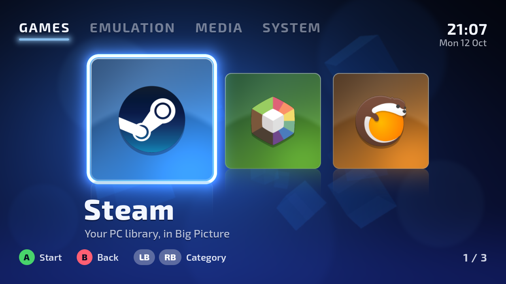
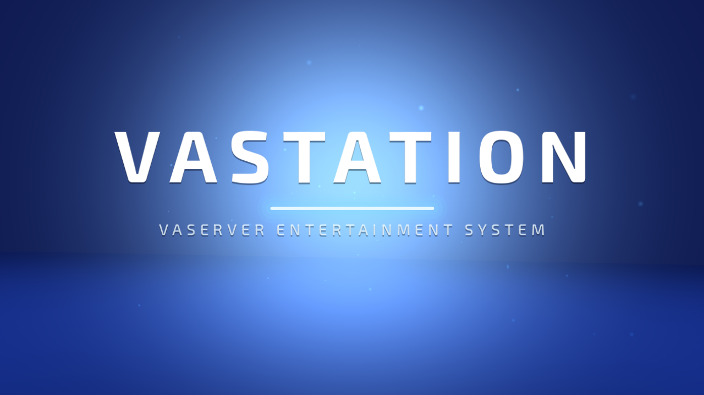
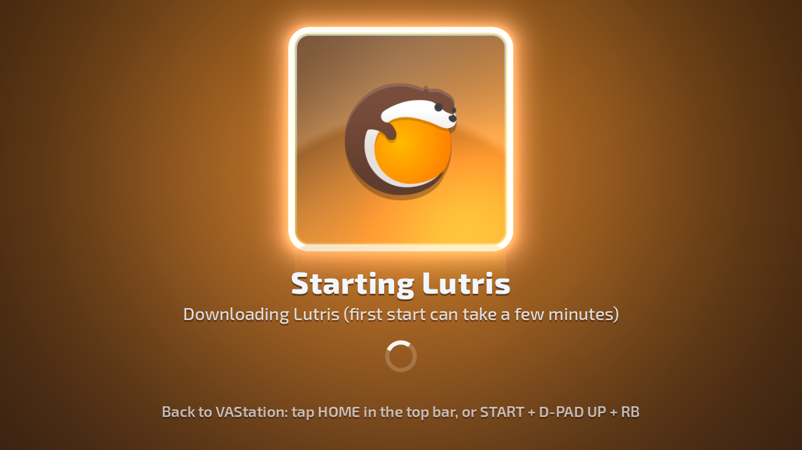
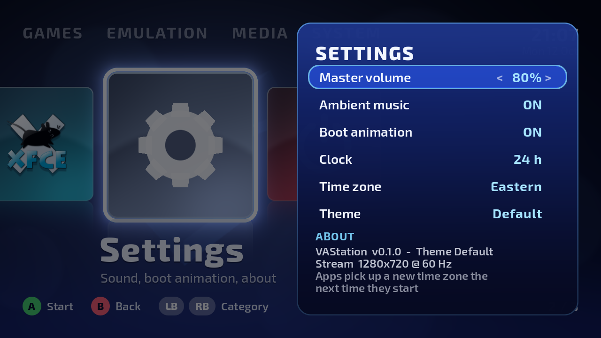
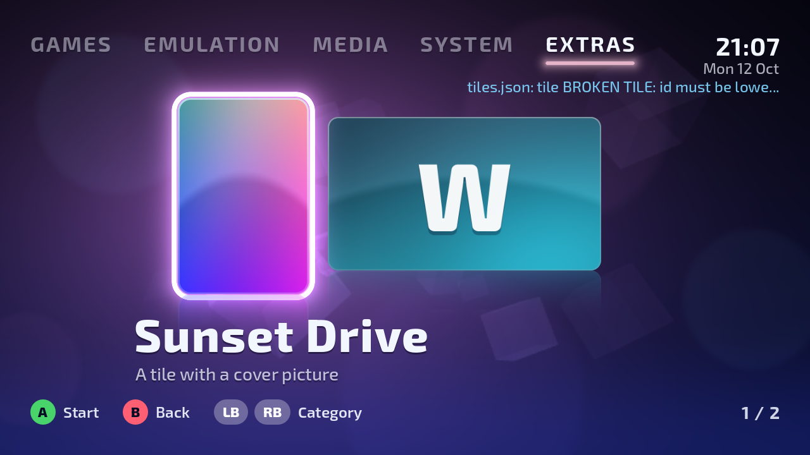
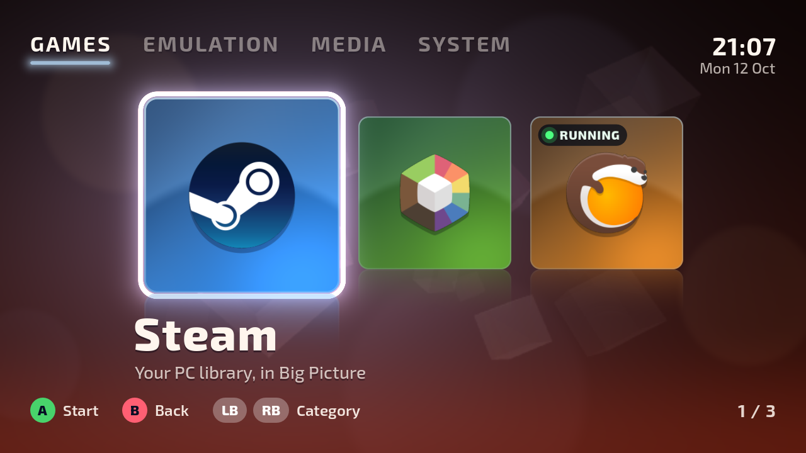

# VAStation

A game launcher for [Wolf](https://games-on-whales.github.io/wolf/stable/) (the Moonlight streaming host from
Games on Whales) that looks and sounds like a 2000s console dashboard: a boot animation, a slow glass-and-fog
background, navigation sounds, big type, and a row of artwork tiles. It replaces the stock "Wolf UI" as the
thing Moonlight opens into, and works with a controller or with touch on a phone.



| Boot | Launching | Settings |
|---|---|---|
|  |  |  |

## What it does
- Starts the apps you already have in Wolf: Steam, Lutris, Prism Launcher (Minecraft), RetroArch,
  EmulationStation, Kodi, Firefox and a desktop, sorted into Games, Emulation, Media and System.
- Shows download progress the first time an app's image is pulled, instead of a black screen.
- Keeps apps running when you go back to the launcher (the tile shows RUNNING; press Y to stop it).
- Puts a **HOME** button in the top bar of apps, so you can get back with a tap.
- Lets you add **your own tiles and images** and **your own themes** (colours, sounds, logos) by dropping
  files into a folder: see [docs/TILES.md](docs/TILES.md) and [docs/THEMES.md](docs/THEMES.md).
- Idles cheaply: 30 frames per second on the home screen, 2 while an app is in front.

## Make it yours
Your own tiles with your own pictures, and themes that change colours, sounds and logos, all without
rebuilding anything:

| Your own tiles ([guide](docs/TILES.md)) | A theme ([guide](docs/THEMES.md)) |
|---|---|
|  |  |

## What you need
- A working Wolf install (the `stable` image, config version 7) that you can already stream from with Moonlight.
- The apps of Wolf's default `user` profile in your Wolf config (they are there unless you removed them).
- Shell access to the machine Wolf runs on.

## Install
In these steps, `/PATH/TO/WOLF` is the folder on your server that the Wolf container mounts as `/etc/wolf`
(the one that contains `cfg/config.toml`).

1. Download and run the installer. It puts the launcher in `/PATH/TO/WOLF/vastation/app`:
   ```bash
   curl -fLO https://raw.githubusercontent.com/frVasili/vastation/main/deploy/install.sh
   VASTATION_DIR=/PATH/TO/WOLF/vastation bash install.sh
   ```
2. Copy the icon: download [deploy/icon.png](deploy/icon.png) to `/PATH/TO/WOLF/vastation/icon.png`.
3. Stop Wolf. (Wolf rewrites its config file while it runs, so edit it only while Wolf is stopped.)
4. Open `/PATH/TO/WOLF/cfg/config.toml` and paste the block from [deploy/wolf-app.toml](deploy/wolf-app.toml)
   as the first `[[profiles.apps]]` entry of the profile with `id = 'moonlight-profile-id'`. Replace every
   `/PATH/TO/WOLF` in it with your real path and set `TZ` to your time zone.
5. Start Wolf. Moonlight now lists **VAStation** next to Wolf UI. Wolf UI keeps working, so you can always
   fall back to it.

To update later, run step 1 again, then end the launcher session and reconnect.

## Controls
| | Controller | Keyboard | Touch |
|---|---|---|---|
| Move | D-pad / left stick | Arrow keys | Tap a tile, or drag the row |
| Start | A | Enter | Tap the focused tile |
| Back | B | Esc | |
| Change category | LB / RB, or up / down | Q / E | Tap a category |
| Stop a running app | Y | Tab | Tap the Y hint |
| Back to the launcher from an app | START + D-pad up + RB | Ctrl+Alt+Shift+W | HOME in the top bar |

The HOME button exists in apps that draw the top bar (most of them; not the desktop, and a fullscreen game
covers it).

## How it works
Wolf starts one container per app. VAStation is one of those apps: the stock public image
`ghcr.io/games-on-whales/base-app` with the launcher mounted into it, so there is no custom image to build
or pull. It is a [Godot 4](https://godotengine.org/) project (GDScript, OpenGL renderer) that draws straight
onto Wolf's virtual display and talks to Wolf's control API over its unix socket. Picking a tile asks Wolf to
start that app in a "lobby" and to move your stream and input to it; when the app exits, Wolf hands the
stream back.

Security note: the launcher holds Wolf's API socket, and that API can start any container. Treat the
launcher's folder like you treat Wolf's own config. Apps started by the launcher never get the socket; the
HOME button works through a small request folder instead.

## Building and testing
- `launcher/` is the Godot project (4.7.2). `tools/shots.sh [outdir] [WxH]` renders a scripted tour of every
  screen with a fake backend under Xvfb (software rendering, no GPU needed) so changes can be reviewed as
  pictures. `tools/test_backend.sh` runs the Wolf backend against `tools/fake_wolf.py`.
- GitHub Actions (`.github/workflows/build.yml`) exports the Linux binary, runs both, and publishes the
  `latest` release that the installer downloads.
- `tools/gen_sounds.py` regenerates the default sounds (pure Python, no samples).

## Licence and credits
The code, the default sounds and the documentation are under the [MIT licence](LICENSE).

The typeface is [Exo 2](https://fonts.google.com/specimen/Exo+2) (SIL Open Font License, `launcher/fonts/OFL.txt`).

The app logos in `launcher/themes/default/art/` belong to their owners and are **not** covered by the MIT
licence. They are included only to identify the apps the tiles start; sources are listed in
`launcher/themes/default/art/SOURCES.md`. Steam is a trademark of Valve Corporation; Firefox is a trademark
of the Mozilla Foundation; the others are the logos of their open-source projects. If you own one of these
and want it removed, open an issue.

VAStation is a fan project. It is not affiliated with or endorsed by Sony, Nintendo, Microsoft, Valve,
Mozilla, or Games on Whales.
